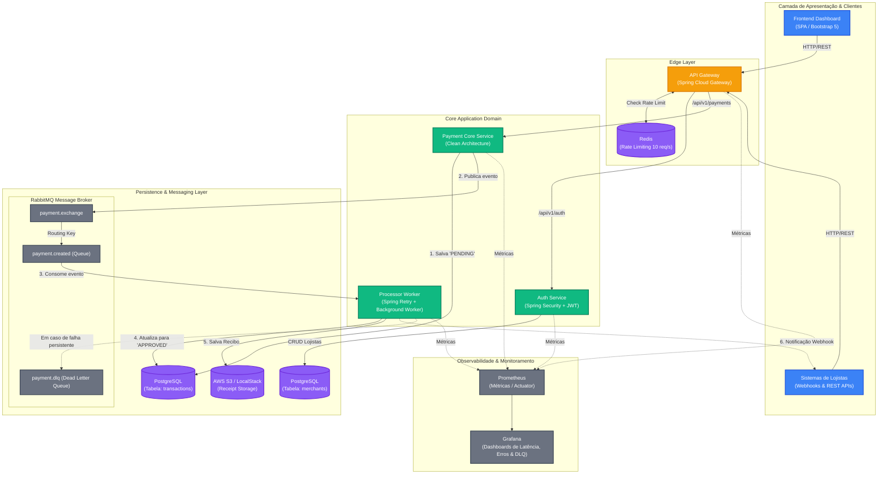

# Documento de System Design: Payment Gateway Engine

## 1. Visão Geral
Este projeto implementa um **Gateway de Pagamento** baseado em uma arquitetura de microsserviços. O sistema foi projetado para oferecer alta disponibilidade, escalabilidade e resiliência, permitindo o processamento assíncrono de transações de pagamento.

## 2. Arquitetura de Alto Nível
O sistema utiliza uma abordagem de **Clean Architecture** em seus serviços de negócio e uma infraestrutura robusta de suporte.

### Stack Tecnológica:
- **Linguagem:** Java 17
- **Framework:** Spring Boot 3
- **Database:** PostgreSQL (gerenciado pelo Flyway)
- **Mensageria:** RabbitMQ
- **Caching/Rate Limiting:** Redis
- **Infraestrutura:** Docker & Docker Compose, AWS S3 (via LocalStack em dev)
- **Observabilidade:** Prometheus & Grafana
- **API Gateway:** Spring Cloud Gateway

### Diagrama da Arquitetura:

## 3. Detalhes dos Componentes

### 3.1. API Gateway (`api-gateway`)
Ponto de entrada centralizado.
- **Roteamento:** Direciona requisições para `auth-service` e `payment-core-service`.
- **Rate Limiting:** Filtro reativo baseado em Redis que limita cada API Key a 10 req/s.
- **CORS:** Configurado para suportar o frontend.

### 3.2. Auth Service (`auth-service`)
Gerenciamento de identidades.
- **Funcionalidades:** Registro, Login, Refresh Token (JWT) e configuracao de webhook do lojista.
- **Segurança:** Spring Security com filtro JWT; rotas `/api/v1/auth/*` sao publicas e as demais exigem Bearer token.
- **Armazenamento:** Tabela `merchants` (PostgreSQL), incluindo `webhook_url`.

### 3.3. Payment Core Service (`payment-core-service`)
Orquestração de pagamentos.
- **Domínio:** Implementa a lógica de negócio principal (Clean Architecture).
- **Endpoints:** `/api/v1/payments` (exige JWT e `X-API-Key` do mesmo merchant).
- **Persistência:** Tabela `transactions` (com `webhook_url` copiada do merchant).
- **Mensageria:** Publica eventos (`payment.created`) para RabbitMQ para processamento assíncrono.

### 3.4. Processor Worker (`processor-worker`)
Processamento em background.
- **Responsabilidades:**
    - Consumo da fila `payment.created`.
    - Atualização do status da transação para `APPROVED`.
    - Geração de recibos e armazenamento em S3 (`S3ReceiptService`).
    - Disparo de webhooks para a URL do lojista (ou `WEBHOOK_DEFAULT_URL`) com suporte a retentativas automáticas (`Spring Retry`).
- **Resiliência:** Configuração de Dead Letter Queue (`payment.dlq`) para mensagens que falham após retentativas.

### 3.5. Frontend Dashboard (`frontend-dashboard`)
SPA.
- **Tecnologias:** Angular, nginx e Tailwind.
- **Features:** Cadastro/Login, Checkout, Tabela de transações, Download de recibos.

## 4. Esquema de Banco de Dados
### 4.1. Tabela `merchants` (`auth-service`)
- `id` (UUID), `company_name` (VARCHAR), `email` (UNIQUE VARCHAR), `password_hash` (VARCHAR), `api_key` (UNIQUE VARCHAR), `webhook_url` (VARCHAR), `created_at` (TIMESTAMP).

### 4.2. Tabela `transactions` (`payment-core-service`)
- `id` (UUID), `merchant_id` (UUID), `amount` (NUMERIC), `status` (VARCHAR), `payment_method` (VARCHAR), `webhook_url` (VARCHAR), `created_at` (TIMESTAMP).

## 5. Fluxo de Processamento (Mensageria)
1. Requisição recebida no `payment-core-service` (autenticada por JWT + API Key).
2. Transação persistida como `PENDING` com a URL de webhook do merchant.
3. Evento publicado em `payment.exchange` com routing-key `payment.created.routing`.
4. `processor-worker` consome a fila `payment.created`.
5. Transação atualizada para `APPROVED`.
6. Recibo gerado no S3 e webhook enviado ao lojista (ou ignorado, com log, se nao houver URL).

## 6. Observabilidade
- **Actuator/Prometheus:** Métricas coletadas em todos os serviços.
- **Grafana:** Dashboards centralizados para monitoramento de latência, taxa de erro, volume de transações e DLQ.

## 7. Estratégia de Deploy
- **CI/CD:** GitHub Actions para automação de build, testes e deploy via SSH.
- **Containers:** Imagens Docker otimizadas para ambientes de desenvolvimento e produção.
